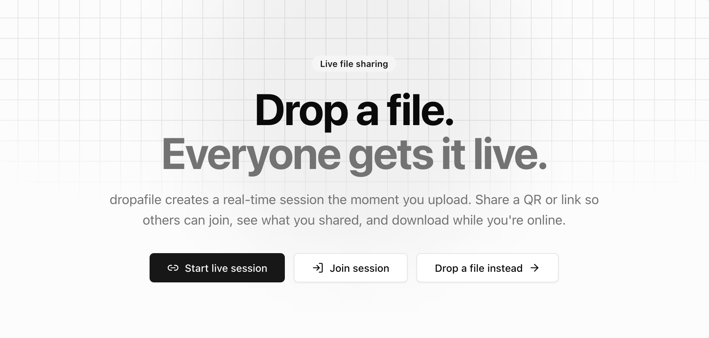

<div>

### dropafile

**Drop a file. Everyone gets it live.**

**Ephemeral, live-session file sharing** — spin up a room, share a link or QR code, and let connected peers download what you share in real time.

</div>

<br/><br/>

<div align="center">

<p>
  <a href="https://github.com/dropafile/dropafile"></a>
  &nbsp;
  <a href="https://github.com/dropafile/dropafile#quick-start"></a>
  &nbsp;
  <a href="https://github.com/dropafile/dropafile/blob/main/CONTRIBUTING.md"></a>
</p>


<br/>
<br/>

<picture>
  <source media="(prefers-color-scheme: dark)" srcset="../.github/screenshot_dark.png"/>
  <source media="(prefers-color-scheme: light)" srcset="../.github/screenshot.png"/>
  
</picture><br/>

**No accounts · No cloud storage · Peer-to-peer while online**

</div>

---

## How it works

Three steps from drop to download — built around **live sessions**, not static upload links.

| Step | | What happens |
|:--:|:--|:--|
| **1** | **Drop a file** | Drag and drop or browse. A live session spins up the moment your file is ready — or **Start live session** first, then upload. |
| **2** | **Share the session** | Send a **QR code** or **link**. Anyone on the page joins the same room instantly — or **Join session** with a pasted link or code. |
| **3** | **Download while live** | Peers see your files in real time and download **directly from your browser** while you stay connected. **Leave** when done — files are removed and the room closes. |

---

## Built for

When you need files in front of people **right now** — not buried in inboxes or waiting on sync folders.

| | |
|:--|:--|
| **Meeting handoffs** | Swap decks, screenshots, or exports with everyone in the room without email threads. |
| **Quick cross-device sends** | Move a file from laptop to phone by opening the same session link on both devices. |
| **Client deliverables** | Share a temporary link for a review package. Remove files when the handoff is done. |
| **Ephemeral by design** | No accounts, no permanent cloud storage. Files disappear when owners leave or remove them. |

---

## In the session

Everything you need once a room is live — from the [dropafile app](https://github.com/dropafile/dropafile).

| Feature | Description |
|---------|-------------|
| **QR + link share** | Copy the session URL, scan a QR code, or share via mail / messaging shortcuts. |
| **Multi-file queue** | Drop several files at once; uploads run sequentially with progress feedback. |
| **Live file catalog** | Real-time `file-added`, `file-removed`, and sync over WebSocket. |
| **Peer-to-peer download** | File bytes flow browser-to-browser while owners stay connected. |
| **Session details** | See connected peers, host badge, share URL, and per-user file counts. |
| **Bulk actions** | **Download all** shared files or **Delete all** of your own in one click. |
| **Same-tab recovery** | Reload without losing your catalog — owned blobs recover from `sessionStorage`. |
| **Supported types** | PNG, JPEG, plain text, JSON, PDF, ZIP |

---

## Under the hood

Open source on [**Cloudflare Workers**](https://workers.cloudflare.com/) — one repo, one deploy.

| Layer | Tech |
|-------|------|
| **Edge API** | Hono · Durable Object session rooms · WebSocket signaling |
| **Web app** | React SPA · live session UI · drag-and-drop dropzone |
| **Transfer model** | Signaling on the worker; file bytes peer-to-peer in the browser |

<details>
<summary><strong>Developers — run locally</strong></summary>

<br />

```bash
git clone https://github.com/dropafile/dropafile.git
cd dropafile
npm install
npm run dev
```

Health check: `curl http://localhost:5173/health`

Deploy: `npm run deploy` · `npm run deploy:staging` · `npm run deploy:production`

Full API surface, env vars, and project layout → [**dropafile README**](https://github.com/dropafile/dropafile#out-of-the-box-features)

</details>

---

<div align="center">

### Ready when you are

Start empty and share the link, or drop a file and go live in one move.

<p>
  <a href="https://github.com/dropafile/dropafile"><strong>View source on GitHub</strong></a>
  &nbsp;·&nbsp;
  <a href="https://github.com/dropafile/dropafile/issues"><strong>Report an issue</strong></a>
  &nbsp;·&nbsp;
  <a href="https://github.com/dropafile/.github/blob/main/CODE_OF_CONDUCT.md"><strong>Code of Conduct</strong></a>
</p>

<sub>MIT · Maintained by <a href="https://github.com/charlite">@charlite</a> · <a href="https://github.com/dropafile">@dropafile</a></sub>

</div>
